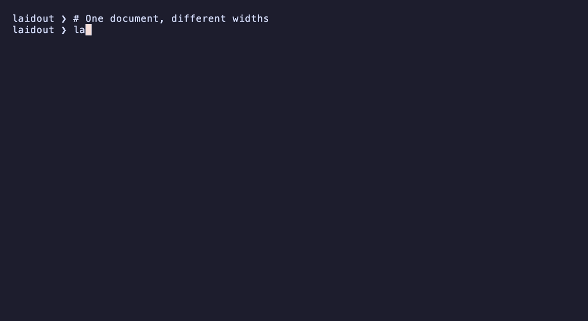

<p align="center"></p>
<h1 align="center">Laidout</h1>
<p align="center"><strong>Build a document once. Make it look right at every width.</strong></p>

[](https://github.com/bryanmatteson/laidout/actions/workflows/ci.yml)
[](https://crates.io/crates/laidout)
[](https://docs.rs/laidout)
[](https://www.rust-lang.org)
[](LICENSE)

Laidout is a standalone pretty-printing kernel with deterministic layout,
application-owned annotations, and reusable allocation control. Build an
immutable `Doc<A>`, prepare it once, then render with a fast column-accurate
strategy or an exact cost-minimizing strategy.

```sh
cargo add laidout
```

Laidout 0.3 supports Rust 1.85 and newer, has no unsafe code, and does not
require annotations to implement `Eq`, `Hash`, `Clone`, or `Debug`.

<p align="center"></p>

The same structured JSON becomes compact or indented as space changes. A
Unicode table keeps its columns aligned and falls back to vertical rows in a
narrow viewport. These are real calls to the library; run
[`examples/readme.rs`](examples/readme.rs) or regenerate the GIF with the
[recording script](scripts/record-readme-demo.py).

## A layout kernel for your formatter

- 📐 **Express structure.** Compose text, optional and mandatory line breaks,
  groups, nesting, alignment, fill layouts, and explicit alternatives. Keep
  content and layout decisions in the same immutable document.
- 🔁 **Prepare once, render repeatedly.** Reuse a prepared document across
  widths and output sinks, with a retained renderer or caller-owned workspace.
- 🎨 **Carry your annotations.** Attach syntax classes, source references,
  styles, or any application value. Resolve output spans or consume annotation
  events through a visitor; nested annotations retain their identity.
- 🌏 **Measure display columns.** Unicode width is measured when text is
  constructed. Host applications can supply an authoritative column count.
- ⚖️ **Choose your strategy.** Fast rendering makes bounded fit decisions;
  Exact selects a deterministic layout with minimum checked cost.
- 🧰 **Control allocations and output.** Warm and fix workspace capacity,
  render into borrowed output, stream to a text sink, or visit the selected
  layout in a custom protocol. Capacity failures are explicit.
- 📊 **Format tables.** Left, right, and center alignment, headers, ragged
  rows, display-width padding, and compact or vertical layout use ordinary
  document nodes and the same annotation model.

Use it in source formatters, decompilers, terminal tools, structured logs, and
editor presentations. Your application decides how annotations become colors,
links, or source maps.

## Quick start

For occasional rendering, use the owned API:

```rust
use std::num::NonZeroU32;

use laidout::{render, Doc, RenderOptions};

let doc = Doc::<u32>::group(Doc::concat([
    Doc::text("status:"),
    Doc::line(),
    Doc::text("ready"),
]));
let options = RenderOptions::new(NonZeroU32::new(12).unwrap());
let output = render(&doc, options)?;
assert_eq!(output.text(), "status: ready");
# Ok::<(), Box<dyn std::error::Error>>(())
```

For repeated rendering, retain a `Renderer`. It reuses its workspace and can
render owned output or write a prepared document directly to `fmt::Write` and
`io::Write` sinks:

```rust
use std::num::NonZeroU32;

use laidout::{Doc, RenderOptions, Renderer};

let prepared = Doc::<u32>::group(Doc::concat([
    Doc::text("alpha"),
    Doc::line(),
    Doc::text("beta"),
])).prepare()?;
let options = RenderOptions::new(NonZeroU32::new(8).unwrap());
let mut renderer = Renderer::new();

let first = renderer.render_prepared(&prepared, options)?;
assert_eq!(first.text(), "alpha\nbeta");

let mut sink = String::new();
renderer.write_fmt(&prepared, options, &mut sink)?;
assert_eq!(sink, first.text());
# Ok::<(), Box<dyn std::error::Error>>(())
```

## Integration choices

| Need | API |
| --- | --- |
| Render once to owned text and spans | `render(&Doc, options)` |
| Reuse allocations across calls | `Renderer` |
| Prepare once, render at many widths | `Doc::prepare` + `Renderer::render_prepared` |
| Write without cloning owned output | `Renderer::write_fmt` or `write_io` |
| Full allocation control | `render_into` with `RenderWorkspace` |
| Custom output protocol | `solve_into` with `LayoutVisitor` |
| Custom annotation model | `Doc<A>` or `Doc::map_annotations` |
| Ingest and classify unstructured text | `from_text_with_annotations` |
| Override display width from a host system | `Doc::text_with_columns` |

The `prelude` module exports the most common document and renderer types.

## Application-owned annotations

Annotations are retained by shared identity, not deduplicated by value. Dynamic
and foreign annotation models require no comparison or hashing traits:

```rust
use laidout::{from_text_with_annotations, IngestOptions, TextKind};

enum Style {
    Token(TextKind),
}

let doc = from_text_with_annotations(
    "hello, world",
    IngestOptions::default(),
    Style::Token,
)?;
let prepared = doc.prepare()?;
assert!(prepared.annotation_count() > 0);
# Ok::<(), Box<dyn std::error::Error>>(())
```

`Doc::text` measures Unicode width when the run is constructed. If a terminal,
editor, or protocol supplies its own width, use `Doc::text_with_columns` to
store that authoritative measurement.

## Fast, exact, and fixed rendering

`LayoutStrategy::Fast` uses prepared first-stop summaries and makes
constant-time fit decisions. `LayoutStrategy::Exact` uses stable Pareto
frontiers to minimize Laidout's checked overflow-and-burden cost. Exact is the
default; choose Fast when latency and linear work matter more than global cost
optimality.

`RenderWorkspace::growable()` expands named buffers as needed. To guarantee
zero allocator calls during rendering, warm the exact prepared
document/width/strategy combination, retain `workspace.capacity()`, and switch
to `WorkspaceMode::Fixed`. Insufficient storage returns a typed error; Laidout
never silently changes strategy or publishes an approximate result.

## Correctness and scope

- Text is validated and measured once; line breaks are structural nodes.
- Preparation rejects documents whose complete candidate output or cost domain
  cannot be represented.
- The `research` feature exposes arbitrary-precision oracle engines and
  footprint inspection used by the verification suite.
- Tables compile to ordinary document nodes and support the same generic
  annotation type as their cells.
- Laidout owns no terminal styling or downstream application vocabulary.

See the [API documentation](https://docs.rs/laidout), [0.3 migration
guide](docs/migration-0.3.md), [table contract](docs/aligned-tables.md), and
[cost proof](docs/cost-model-proofs.md). Runnable integrations live in
[`examples/standalone.rs`](examples/standalone.rs) and
[`examples/flexible.rs`](examples/flexible.rs).

## Contributing and security

The contribution process is defined in [CONTRIBUTING.md](CONTRIBUTING.md).
Report vulnerabilities through [SECURITY.md](SECURITY.md), never through a
public issue. Community participation is governed by
[CODE_OF_CONDUCT.md](CODE_OF_CONDUCT.md).

The [media recipe](docs/assets/README.md) documents the example and GIF capture.

Laidout is available under the [MIT license](LICENSE).
